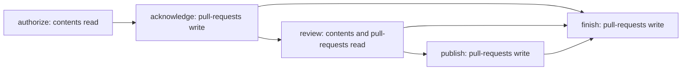

# Design

## Workflow jobs

The caller pins `review.yml` to a full commit SHA.
The entry workflow calls its relative `review-worker.yml`, so both workflows use that commit.

Authorization precedes the receipt reaction and per-PR cancellation.
The worker checks the command and current requester permission again before inference.
Only `review` checks out source or receives the inference key.
`publish` runs only after a successful review.
`finish` updates request reactions after success or failure, but skips cancellation and requests whose acknowledgement job was skipped.
Retrying a failed `finish` job does not rerun successful publication.
Keep cancellation in the entry workflow; sharing its concurrency group with a caller or worker can cancel the run itself.

## Source selection

| Runner directory | Selected source | Use |
| --- | --- | --- |
| `reviewer-source/` | `job.workflow_repository` and `job.workflow_sha` | Trusted executable helpers and configuration |
| `repository-default/` | Consumer default branch | Instruction files only |
| `pr-source/` | Consumer repository at the API-selected PR-head SHA | Untrusted review data |

The PR head is fetched from the consumer repository, not directly from its fork.
The fork name is display metadata and may be null for a deleted fork.

Python CLI steps run as modules with `working-directory: reviewer-source`.
Imports must not resolve from the PR checkout.
Validated PR base/head SHAs determine the merge base; the PR base need not be the default branch.
Git helpers disable hooks, external diff drivers, and text converters.
Checkouts do not retain Git credentials.

Instruction assembly validates every selected source before writing a bundle outside the checkout.
It preserves file contents, labels source paths, logs paths rather than contents, and includes a duplicate resolved source only as review-specific guidance.
Both phases read the same `/instructions/AGENTS.md` snapshot.
The image entrypoint disables project configuration discovery and supplies private runtime directories.

## Credential and filesystem boundaries

The trusted host launcher receives `CSCS_INFERENCE_KEY` and writes private Caddy configuration containing that key and a random per-run client token.
Only the proxy mounts that configuration.
The reviewer receives `CSCS_REVIEW_PROXY_URL`, including `/v1`, and `CSCS_REVIEW_PROXY_TOKEN`.
The canonical upstream and allowed routes are defined in [config/credential-proxy.json](../config/credential-proxy.json); there is no direct-key fallback.

The reviewer receives no GitHub/Actions token, SSH agent, host home directory, or Docker socket.
It runs as UID/GID 1000 with a read-only root filesystem, dropped capabilities, and `no-new-privileges`.
Source and supplied inputs are read-only mounts; `/work` and `/tmp` are private writable scratch space.
The proxy and reviewer use separate containers on a per-run network.
The proxy has no published ports, admin API, autosave, payload logs, or retries.
Neither container receives the Docker socket.

The launcher snapshots inputs, enforces the host deadline, and compares `HEAD` and Git status before and after execution.
It attempts bounded cleanup of both containers, the network, and private configuration on success, failure, or cancellation.
Container isolation assumes a trusted runner, container engine, kernel, and inference upstream.
A container escape or an upstream response that echoes the real key can expose credentials.
The [consumer limits](../README.md#web-access-and-private-source) describe network and private-source risks.

Policy prohibits editing source, executing PR code or tests, installing packages, and agent-side publication.
The shell can still execute readable code; read-only mounts do not enforce that policy.

## Final-response contract

Inspection uses tools to gather evidence.
Finalization uses the same private session with tools denied and provider-level `tool_choice: none`.
The final task reapplies the image-baked [reviewer policy](../image/grumpy-reviewer.md).

Extraction requires completed text from one final assistant message and a successful runner-controlled final phase.
OpenCode can reconcile text without `step_finish`; emitted finish events must report `stop` or `end_turn`.
Malformed phases, changed sessions, finalizer tool use, unfinished text, failed finish events, and continuation responses fail without publication.
See [limits and diagnostics](../README.md#limits-and-diagnostics) for incomplete-inspection behavior and retained artifacts.
